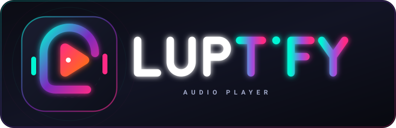

# LUPTIFY 🎵
> A Modern, Lossless Web Music Streaming Platform inspired by modern streaming interfaces (Spotube, ViMusic, InnerTune, and Apple Music).



## ✨ Overview
**LUPTIFY** is a full-featured, high-performance music streaming application built with a lightweight Python/FastAPI backend and a vanilla HTML5/CSS3/JavaScript frontend powered by the WebAudio API.

It seamlessly integrates with the YouTube Music catalog, supports offline storage via IndexedDB, word-follow synchronized lyrics with multi-language translation, and dynamic cosmic ambient aura lighting that adapts to album artwork colors.

---

## 🚀 Key Features

- **🎧 High-Fidelity Lossless WebAudio Pipeline**:
  - WebAudio 32-bit Float 48,000Hz audio rendering engine with dual-track crossfading.
  - Interactive Graphic Equalizer with real-time spectrum visualizer.
  - ReplayGain volume normalization and adjustable playback speed (0.75x – 2.0x).

- **🌌 Dynamic Cosmic Ambient Aura**:
  - Multi-layer fluid ambient background with breathing glowing orbs.
  - Real-time dominant color extraction from album artwork that transitions smoothly across glassmorphic panels.

- **🎤 Synchronized & Translated Lyrics**:
  - Word-follow and line-by-line synchronized lyrics powered by LRCLib.
  - Live multi-language lyric translation (Malay, English, Spanish, Japanese, Korean, French, German, and more).
  - Clean solid-white lyrics view with auto-scrolling.

- **💾 100% Offline Music Storage**:
  - Download songs and lyrics directly into browser storage using IndexedDB.
  - Dedicated "Downloaded" tab with instant offline playback and zero network usage.

- **📱 Device Aspect-Ratio Auto-Matching (Android & Desktop)**:
  - Built with dynamic viewport units (`100dvh`) and safe-area inset adaptation for modern smartphones.
  - Floating mini player docked above bottom navigation with touch-friendly controls.
  - Fullscreen stage overlay with vinyl disc animation and responsive 1:1 artwork scaling.

- **🔥 Curated Recommendations & YouTube Music Charts**:
  - Live trending hits, curated genre playlists, and quick picks.
  - Instant radio generation based on currently playing songs.
  - Fast in-memory catalog caching for sub-millisecond navigation.

- **⌨️ Desktop Productivity Shortcuts**:
  - `Space`: Play / Pause
  - `ArrowLeft` / `ArrowRight`: Seek ±5 seconds
  - `ArrowUp` / `ArrowDown`: Volume ±5%
  - `M`: Mute / Unmute
  - `L`: Open Lyrics Stage
  - `Q`: Toggle Play Queue
  - `S`: Shuffle Queue
  - `R`: Cycle Repeat Mode
  - `F`: Fullscreen Stage

---

## 🛠️ Tech Stack

- **Backend**: Python 3.10+, [FastAPI](https://fastapi.tiangolo.com/), [Uvicorn](https://www.uvicorn.org/), `ytmusicapi`, `yt-dlp`, `httpx`
- **Frontend**: Vanilla ES6+ JavaScript, CSS3 Glassmorphism with hardware-accelerated animations, HTML5 WebAudio API, IndexedDB
- **Tunneling**: Cloudflare Tunnel (`cloudflared`) for secure mobile device access without port forwarding

---

## 📦 Installation & Setup

### 1. Clone the Repository
```bash
git clone https://github.com/YOUR_USERNAME/LUPTIFY.git
cd LUPTIFY
```

### 2. Create and Activate Virtual Environment
```bash
# Windows
python -m venv .venv
.\.venv\Scripts\activate

# Linux / macOS
python3 -m venv .venv
source .venv/bin/activate
```

### 3. Install Dependencies
```bash
pip install -r requirements.txt
```

### 4. Start the Server
```bash
# Windows quick launch
start.bat

# Or via command line
uvicorn server:app --host 0.0.0.0 --port 8000 --reload
```

Open your browser and navigate to `http://127.0.0.1:8000`.

---

## 📄 License
This project is for personal and educational use. Audio content is provided via YouTube / YouTube Music.
